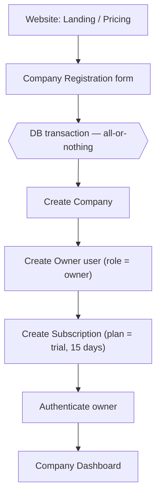
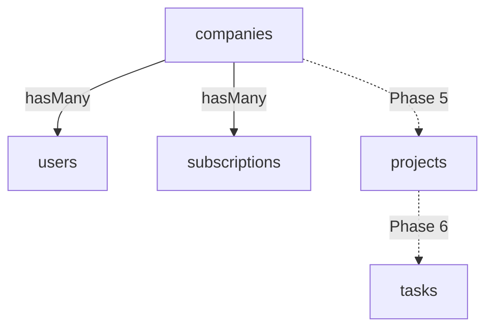
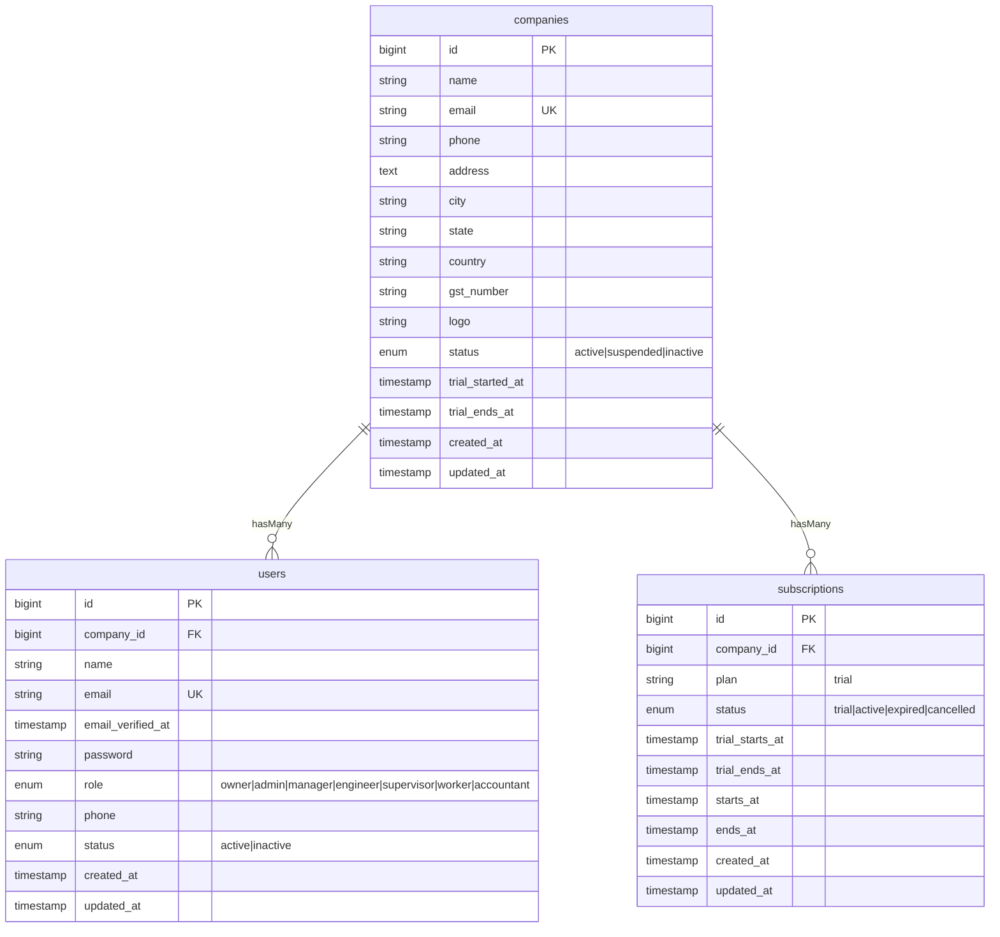

# Best CPMS — Phase 1: Foundation

**Construction Project Management System (Best CPMS)** — a multi-tenant Laravel SaaS.
This document covers **Phase 1 only**: database foundation, models, relationships, and a demo seeder. No controllers, auth screens, or UI yet — those are Phase 2.

- **Laravel:** 13.x (installed: `laravel/framework` v13.32.0)
- **PHP:** ^8.3
- **Database:** MySQL (`.env` → `DB_DATABASE=lr_test`)
- **Project root:** `/var/www/html/lr_test`

> Tenant model: every business record belongs to a **company** (the tenant) through a `company_id`. A user from Company A must never see Company B's data — enforced in later phases via policies, scopes, and middleware.

---

## A. Architecture (registration → dashboard)



Plain-text fallback:

```
Website → Register Company → [ Company → Owner → Trial Subscription ]  → Login → Dashboard
                              \_____ one atomic transaction _____/
```

Multi-tenant shape (Phase 1 solid, later dotted):



---

## B. ER diagram



Keys & rules:

- `companies.email` — **unique**.
- `users.company_id` → `companies.id`, **cascade on delete** (deleting a tenant removes its users).
- `subscriptions.company_id` → `companies.id`, **cascade on delete**.
- Indexes: `companies.status`; `users(company_id, role)`; FK columns are indexed automatically.

---

## C. Folder structure (Phase 1 files marked ★)

```
lr_test/
├── app/
│   ├── Models/
│   │   ├── Company.php          ★ tenant root
│   │   ├── User.php             ★ tenant-scoped, role-aware
│   │   └── Subscription.php     ★ trial / billing state
│   ├── Http/Controllers/        (Phase 2+)
│   └── Providers/
├── database/
│   ├── migrations/
│   │   ├── 0001_01_01_000000_create_users_table.php        (base)
│   │   ├── 2026_09_18_113124_create_companies_table.php    ★ fixed
│   │   ├── 2026_09_18_113410_create_subscriptions_table.php ★
│   │   └── 2026_09_18_120000_add_company_fields_to_users_table.php ★ new
│   ├── factories/
│   │   ├── CompanyFactory.php       ★ new
│   │   ├── SubscriptionFactory.php  ★ new
│   │   └── UserFactory.php          ★ updated
│   └── seeders/
│       └── DatabaseSeeder.php       ★ transactional demo tenant
├── routes/web.php                (Phase 2: registration/login/dashboard)
├── config/                       (auth, database, session — defaults)
└── .env                          MySQL config (gitignored)
```

---

## D. Migrations (what each file does)

| File | Purpose |
| --- | --- |
| `..._create_companies_table.php` | Creates `companies` (tenant root). **Fixed:** removed the misplaced `company_id`/`role` columns and the duplicate `phone`/`status` that previously made this migration crash. |
| `..._add_company_fields_to_users_table.php` | Adds `company_id` (FK → companies, cascade), `role`, `phone`, `status` to the standard users table. Runs after `companies` exists. |
| `..._create_subscriptions_table.php` | Creates `subscriptions` with `company_id` (FK, cascade), `plan`, `status`, and trial/active date windows. |

> **Why a separate users migration?** Laravel ships the base `users` table in its own migration. Rather than editing framework-owned code, tenant fields are added in a dedicated, reversible migration — the conventional "modify existing table" pattern.

---

## E. Models (fillable / casts / relationships)

| Model | Mass-assignable (`$fillable`) | Guarded (set in code) | Casts | Relationships |
| --- | --- | --- | --- | --- |
| `Company` | name, email, phone, address, city, state, country, gst_number, logo, status, trial_started_at, trial_ends_at | — | trial dates → datetime | `users()`, `subscriptions()`, `owner()` |
| `User` | name, email, password, phone | **company_id, role, status** | password → hashed, email_verified_at → datetime | `company()` |
| `Subscription` | company_id, plan, status, trial/starts/ends dates | — | all date fields → datetime | `company()` |

**Security note (this matters):** `company_id`, `role`, and `status` are deliberately **kept out of `User::$fillable`**. If they were mass-assignable, a crafted request could post `role=owner` or `company_id=2` and escalate privileges or jump tenants. They are set explicitly server-side (see the seeder, and the Phase 2 registration flow).

Helpers included for the dashboard/trial logic: `Company::isOnTrial()`, `trialExpired()`, `trialDaysRemaining()`; `User::isOwner()`, `isAdmin()`, `hasRole()`; `Subscription::onTrial()`, `isActive()`. Role/status values are exposed as class constants (e.g. `User::ROLE_OWNER`, `Company::TRIAL_DAYS`).

---

## F. Commands

Run from the project root (`/var/www/html/lr_test`):

```bash
# One-time setup (only if needed)
composer install                 # if vendor/ is missing
php artisan key:generate         # if APP_KEY is empty in .env

# Build the schema
php artisan migrate

# Optional: load the demo tenant
php artisan db:seed

# Rebuild from scratch (drops all tables) + demo data
php artisan migrate:fresh --seed
```

---

## G. Environment setup (`.env`)

Your `.env` is already pointed at MySQL:

```dotenv
DB_CONNECTION=mysql
DB_HOST=127.0.0.1
DB_PORT=3306
DB_DATABASE=lr_test
DB_USERNAME=pmauser
DB_PASSWORD=********      # keep real
```

Before running migrations, make sure the database exists:

```sql
CREATE DATABASE lr_test CHARACTER SET utf8mb4 COLLATE utf8mb4_unicode_ci;
```

Reminders: `.env` is gitignored (keep it that way); set `APP_DEBUG=false` and `APP_ENV=production` before any real deployment.

---

## H. Run & verify the migration

```bash
php artisan migrate
php artisan migrate:status        # every migration should show "Ran"
```

Verify the tables directly:

```bash
php artisan tinker
>>> Schema::hasColumn('users', 'company_id');   // true
>>> \App\Models\Company::count();               // 0 (or 1 after seeding)
```

Or in MySQL:

```sql
SHOW TABLES;                 -- companies, users, subscriptions, ...
DESCRIBE users;              -- company_id, role, phone, status present
DESCRIBE companies;          -- no company_id/role; single phone/status
```

---

## I. Demo / seed data

`php artisan db:seed` creates one demo tenant **inside a transaction** (company + owner + trial subscription succeed or fail together — the same shape Phase 2 registration will use):

- Company: **ABC Construction** (15-day trial active)
- Owner login: **owner@demo.test** / **password**  ← dev-only, change before real use
- Subscription: plan `trial`, status `trial`

No real secrets are stored in source. The seeder is idempotent — it skips if `owner@demo.test` already exists.

---

## J. Phase 1 verification checklist

- [ ] `php artisan migrate` runs with **no errors**.
- [ ] `migrate:status` shows companies, subscriptions, and add-company-fields as **Ran**.
- [ ] `companies` table has **no** `company_id`/`role`, and only **one** `phone` and **one** `status`.
- [ ] `users` table has `company_id` (FK), `role`, `phone`, `status`.
- [ ] `subscriptions` table has `company_id` (FK) and the trial/date columns.
- [ ] `php artisan db:seed` creates ABC Construction + owner + trial subscription.
- [ ] In tinker: `Company::first()->users` and `->subscriptions` return the seeded records; `User::first()->company` returns the company.
- [ ] `User::first()->trashed`… i.e. deleting a company cascades to its users/subscriptions (optional check).

When all boxes pass, reply **"Phase 1 complete"** and we'll move to **Phase 2 — Authentication** (company registration form, login/logout, dashboard, trial calculation).
